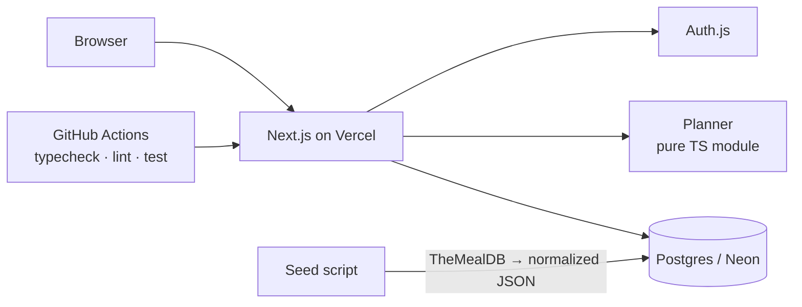

# CookFlow

**Plan your next few meals around what's already in your fridge, so the half onion from Monday ends up in Wednesday's soup.**

---

## Why

Most home cooks plan one meal at a time. They pick tonight's recipe without thinking about the rest of the week, so half an onion, a handful of herbs, or the rest of a pack of chicken sits in the fridge until nobody wants to use it. Tools like SuperCook, or simply asking ChatGPT, answer "what can I cook tonight?" Meal planners like Samsung Food and Cooklist do plan ahead, but they handle changes poorly, and none of them ask "how do I use all of this across the week?"

CookFlow plans several meals together instead of one at a time. It looks at everything in your pantry, picks recipes that use up opened and expiring items first, and simulates each meal so the next one is planned around what's actually left. When you cook a meal, your pantry updates, and the next plan starts from there.

**Who it's for:** intermediate home cooks who cook 3–6 meals a week. They're skilled enough to judge a recipe for themselves, and they cook often enough that poor planning causes real waste.

**What success looks like** (estimated per cook):

| Outcome | Today | Target |
|---|---|---|
| Hard-to-use leftovers | ~400 g / month | 200 g / month |
| Distinct meals cooked | 6 / month | 10 / month |
| Meal prep time | ~60 min | 45 min |

## What it does

- Track ingredients in practical terms ("half an onion", "6 eggs") instead of grams, with optional expiry dates
- Get single-meal suggestions ranked by how well they fit your pantry
- **Generate a 2–5 meal plan** that uses opened and expiring items first
- See your projected hard-to-use leftovers **before → after** the plan, plus a shopping list for anything missing
- Filter by diet (vegetarian)
- Mark a meal cooked and your pantry updates automatically

No setup needed to try it: **Load sample pantry** fills a realistic fridge in one click.

## How the planner works

The planner is a greedy loop with simulated pantry depletion. In each round it scores every candidate recipe against the *current* simulated pantry, picks the best one, and deducts that recipe's ingredients as if it had been cooked. The next round then sees what's really left: the half onion that Monday's meal didn't use. Recipes that cover less than 60% of their non-staple ingredients from the pantry are skipped.

```
score(r) = use(r) − γ·newPartial(r) − δ·missing(r)
```

- `use(r)`: how much of the pantry the recipe uses up, as the share of each item it finishes (so 4 garlic cloves don't outweigh a pack of chicken). Each item is weighted higher if it's already opened or expires soon.
- `newPartial(r)`: penalty for each item the recipe would leave half-used.
- `missing(r)`: penalty for each ingredient you'd have to buy.

**Why greedy, not an optimal solver:** choosing the best set of N recipes is a set-packing problem. With ~100 recipes and N ≤ 5 an exact solver would run, but greedy has three advantages for an MVP:

- It's explainable: "we used your half onion first."
- It runs in O(N · |R| · k), far below the 5-second target for generating a plan.
- It's deterministic, so it's fully unit-tested.

The downside is that greedy can miss the globally best combination. A test fixture documents one such case on purpose.

## Architecture



## Key decisions and trade-offs

| Decision | Why | Cost |
|---|---|---|
| One canonical unit per ingredient, chosen per food: counts for produce, grams for meat, fish, cheese, and dry goods, millilitres for milk and cream | No runtime unit conversion; matches how people describe their fridge and how recipes measure each food | Converting recipe measures like "2 chicken breasts" into grams is an estimate made once, at import |
| An "opened" flag on pantry items | A weight can't tell a leftover from a smaller pack, so opened items are recorded, not guessed | One more field to fill in when adding an item |
| Keep the recipe's original measure text alongside the canonical quantity | Recipes show ingredients exactly as the source wrote them; the planner uses the normalized number | Two representations of each quantity to keep in sync in the seed |
| Seeded recipe set instead of a live API | Deterministic, fast, no rate limits; the planner needs all candidates in memory | Smaller recipe variety (~_<n>_ recipes) |
| Greedy planner | Simple, explainable, testable | Can miss the globally best combination |
| Leftovers measured as a count of opened items, not grams | Comparable across foods with different units | Doesn't capture how much of an item is left, only that it's open |
| Idempotent "mark cooked" in a transaction | Double clicks or retries never double-deduct the pantry | — |

## Running locally

```bash
cp .env.example .env.local   # DATABASE_URL (use a Neon dev branch, not production), AUTH_SECRET,
                             # AUTH_GITHUB_ID/SECRET, AUTH_GOOGLE_ID/SECRET (see "Sign-in setup" below)
                             # TEST_DATABASE_URL (optional): runs the *.db.test.ts tests against that database
npm install
npm run db:migrate
npm run dev
npm test
```

### Sign-in setup

"Try the demo" works without any of this. For real sign-in, create one OAuth app per provider for local development and another for production, so a leaked local secret can't sign in to the live site. Each environment reads the same variable names: `.env.local` locally, Vercel's Production environment variables in production.

| Provider | Where | Callback URL |
|---|---|---|
| GitHub | GitHub → Settings → Developer settings → OAuth Apps; homepage `http://localhost:3000` or your domain | `http://localhost:3000/api/auth/callback/github` (local), `https://<your-domain>/api/auth/callback/github` (production) |
| Google | Google Cloud console → Google Auth Platform → Clients → Web application (External audience; add yourself as a test user or publish the app) | `http://localhost:3000/api/auth/callback/google` (local), `https://<your-domain>/api/auth/callback/google` (production) |

On Vercel, set `AUTH_SECRET` and the provider ids and secrets for Production. Preview deployments get a new URL each time, so OAuth sign-in isn't set up there; use the demo on previews.
